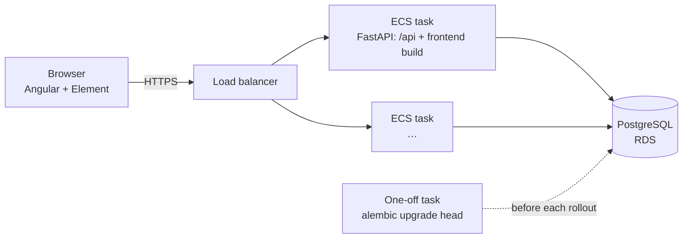
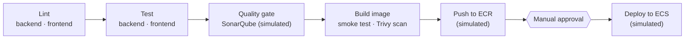

# Staff & Skill Planning Tool

An internal tool for team leads: import employees from a CSV, keep track of
their skills and proficiency levels, and answer questions such as *"who knows
Kubernetes at an advanced level?"* without asking around in chat.

> **Status: complete (M11).** All four features — employee import, employee
> overview, skill assignment and skill search — work in the backend and the
> frontend, ship as one container image and pass a CI/CD pipeline.
> Design decisions are recorded in [docs/adr](docs/adr/README.md). Each
> milestone of the [Roadmap](#roadmap) is a self-contained commit with its own
> tests.

## Tech stack

| Layer    | Choice                                                                     |
| -------- | -------------------------------------------------------------------------- |
| Backend  | Python 3.12, FastAPI, SQLAlchemy 2.0, psycopg 3, PostgreSQL, Alembic        |
| Frontend | TypeScript, Angular 22 (standalone, signals, zoneless), Siemens Element     |
| Tooling  | uv, ruff, mypy, pytest · npm, ESLint, Prettier, vitest · Docker, Compose    |

## Repository layout

```
.
├── .github/workflows the CI/CD pipeline
├── backend/          FastAPI application (uv project)
│   ├── app/          application code
│   └── migrations/   Alembic migrations
├── frontend/         Angular application (npm project)
├── docker/postgres/  database init script (creates the test database)
├── docs/adr/         architecture decision records
├── Dockerfile        the application image (API and frontend)
├── samples/          CSV files to try the import with
└── docker-compose.yml
```

One repository rather than two: the backend contract and the frontend that
consumes it change together, and at this size a split would only add
coordination overhead. The two applications stay independently buildable, and
ship together as one image ([ADR 0003](docs/adr/0003-single-image.md)).

## Architecture



The backend is layered thinly: the routers in `app/api` (`*_api.py`) handle
HTTP (status codes, problem details), the services in `app/services`
(`*_service.py`) hold the queries and rules, `app/models.py` the schema; the Pydantic models in `app/schemas.py` are the API contract, and the
frontend's types are generated from it. The reasoning behind the main choices
is in the [architecture decision records](docs/adr/README.md).

## User interface

The home page is what the tool is for: finding the people who have the skills a
project needs. Skill criteria sit in a deep blue band at the top, the employees
who match below, all of them while no skill is listed. Looking after the data —
the skill catalogue and importing employees — is under **Manage** in the header,
and those pages lead back with a breadcrumb.

The look is Siemens Element's public theme recoloured with Siemens' public brand
colours, since Element's Siemens brand theme (`@simpl/brand`) is internal:
deep blue `#000028` for the header and the search, petrol `#009999` as the accent
(darkened to `#007373` where text has to stay readable on white), greys tinted
with deep blue, and Arial, Siemens' substitute for Siemens Sans.
`frontend/src/styles.scss` derives the theme by replacing the accent colours in
Element's own, so every Element component follows. Proficiency levels deepen
from light petrol to deep blue, as levels are an order rather than a status.

## Prerequisites

- [uv](https://docs.astral.sh/uv/) (Python toolchain and dependency manager)
- Node.js 22+ and npm 11+
- Docker (for PostgreSQL)
- For the `make` shortcuts: Windows and GNU make, e.g. `scoop install make`

## Quick start

### Everything at once

```bash
make start     # database, migrations, then backend and frontend in their own windows
make up        # or: everything as containers, built from the image, on :8080
make stop      # stop backend, frontend and all containers (data is kept)
make restart
make clean     # stop, then delete the containers and the database data
make test      # all tests with coverage reports, against a throwaway database
```

The `Makefile` is for Windows and runs its commands in cmd, so it works the
same from cmd, PowerShell and Git Bash; each target is the handful of commands
it shows. `make start` opens the backend and the frontend in two minimised
windows, which show their logs, and returns once both answer. The frontend
reloads on changes; after backend changes run `make restart`, or run
`uv run uvicorn app.main:app --reload` in a terminal of its own instead.
`make stop` stops the servers by the port they listen on (8000, 4200), so it
also stops servers started by hand. On Linux and macOS, run the steps below.

### Database

```bash
docker compose up -d --wait db   # PostgreSQL 17 on localhost:5432
```

This creates two databases: `skills` for the application and `skills_test`
for the test suite, which migrates it from scratch on every run.

### Backend

```bash
cd backend
uv sync                               # create .venv from uv.lock
uv run alembic upgrade head           # apply migrations
uv run python -m scripts.seed         # optional: fictional demo data (empty database only)
uv run uvicorn app.main:app --reload  # http://localhost:8000/docs
```

The API is documented with OpenAPI. Swagger UI at `/docs` lists every endpoint
with its parameters, response schemas and error responses, and **Try it out**
sends real requests. Errors use [RFC 9457](https://www.rfc-editor.org/rfc/rfc9457)
problem details (`application/problem+json`).

New migration after a model change:
`uv run alembic revision --autogenerate -m "<what changed>"`, then review the
generated file before applying it.

Configuration comes from the environment; every variable is prefixed with
`APP_` and documented in `backend/app/core/config.py`. Create `backend/.env`
for local overrides, for example:

```dotenv
APP_ENVIRONMENT=local
```

### Frontend

```bash
cd frontend
npm ci                  # install from package-lock.json
npm start               # http://localhost:4200, proxies /api to the backend on :8000
```

The API types in `src/app/api/schema.ts` are generated from the backend's
OpenAPI schema. After changing the API, regenerate them with
`npm run api:types` (needs `uv`, not a running backend); a type error in the
frontend then shows every place the change affects.

## Running in containers

```bash
make up      # docker compose --profile app up --build --detach --wait
make stop    # stops these containers along with everything else
```

This builds the image and starts the database, a one-off `migrate` container
(`alembic upgrade head`) and the application. Port 8080 differs from the
development servers, so both can run at once; Swagger UI is at
<http://localhost:8080/docs>. `make stop` and `make clean` stop these
containers too.

The application is **one image** (`Dockerfile` at the repository root): the
API and the frontend it serves, so there is one service to deploy and scale.
The image is built in three stages — the frontend with Node.js, the backend's
dependencies from `uv.lock` without development tools, and a
`python:3.12-slim` runtime with only the virtual environment, the code and the
built frontend — and runs one uvicorn process as a non-root user on port 8000.

FastAPI serves the frontend itself rather than putting nginx in the same
container, which would need a process supervisor:

- Paths that are not files get `index.html`, so links into the app work, but
  unknown paths under `/api/` stay `404` problem details.
- Files with a content hash in their name are cached for a year, everything
  else is revalidated; responses are gzip-compressed.
- Requests larger than 12 MB are refused by their `Content-Length` before the
  body is read, just above the import's 10 MB limit.

How the image is deployed to ECS is described in
[CI/CD](#cicd).

## Skill catalogue

Skills come from one managed list, so the same skill is never stored under two
spellings. The catalogue page (`/skills`) adds, renames and removes skills, and
imports a CSV file with a `name` column (`samples/skills.csv` has 44 to start
with). Everywhere else, skills can only be chosen from the catalogue: the skill
inputs on the employee panel and the search page accept a suggestion, never
free text.

- **Names are unique ignoring case, spaces and punctuation**, so `Node.js`,
  `nodejs` and `Node JS` are one skill. `+` and `#` count as letters (`plus`,
  `sharp`), which keeps `C`, `C++` and `C#` apart. The comparison key is stored
  in `skill.key` with a unique index, so two concurrent requests cannot create
  the same skill twice.
- **Renaming** changes the name for everyone who has the skill; renaming into
  another skill's name is refused rather than merging the two.
- **Removing** is only possible while nobody has the skill.
- **Importing** adds the names that are new and leaves existing ones alone, so
  importing the same file again changes nothing; over-long names are reported
  per row.

| Endpoint                            | Does                                                          |
| ----------------------------------- | ------------------------------------------------------------- |
| `GET /api/v1/skills?q=`             | list, with how many employees have each skill                 |
| `POST /api/v1/skills`               | add; `409` names the existing skill on a clash                |
| `PATCH /api/v1/skills/{id}`         | rename; `409` on a clash                                      |
| `DELETE /api/v1/skills/{id}`        | remove; `409` while employees have it                         |
| `POST /api/v1/skills/import`        | add the names from a CSV file                                 |
| `PUT /api/v1/employees/{id}/skills` | set an employee's skills by `skill_id`; unknown ids are `422` |

## Departments and locations

Departments and locations are records of their own, which employees refer to
([ADR 0011](docs/adr/0011-departments-and-locations.md)). An import adds the
ones it has not seen; names that differ only in case, spaces or punctuation are
the same, as for skills, and the first spelling stays.

They filter the employee list: `GET /api/v1/employees?department=Mobility&department=Healthineers&location=Munich`
keeps the employees in any of the departments and at any of the locations, by
name, combined with the skill criteria and `q`. `GET /api/v1/departments?q=` and
`GET /api/v1/locations?q=` find them by part of their name. On the home page they
are under **Filters**, below the skills in the search band, as they narrow down
the same search of all employees: a panel to choose several departments and
locations from those the database has, applied with **Apply**, and shown next to
it as removable filters.

## Searching by skill

"Who knows Kubernetes at an advanced level?" is a filter on the employee list:

```
GET /api/v1/employees?skill=kubernetes:advanced
```

`name:level` matches employees with that skill at the level **or higher**, so
`advanced` also finds experts; `name` alone matches any level. Repeat `skill`
to require several skills at once, e.g.
`?skill=kubernetes:advanced&skill=python:intermediate`. Skill names are matched
like in the catalogue, ignoring case, spaces and punctuation, a misspelt level is rejected rather than matching nobody, and
the filter combines with `q`, `department`, `location`, sorting and paging.

Levels are stored as integers (1 = beginner … 4 = expert), so "or higher" is a
plain `level >= 3`, answered from the `(skill_id, level)` index.

## Importing employees

`POST /api/v1/imports` takes a CSV file with a header row:

| Column            | Required | Notes                                         |
| ----------------- | -------- | --------------------------------------------- |
| `employee_number` | yes      | identifies the employee across imports        |
| `first_name`      | yes      |                                               |
| `last_name`       | yes      |                                               |
| `email`           | yes      | unique, stored in lower case                  |
| `department`      | no       | added to the departments if new               |
| `job_title`       | no       |                                               |
| `location`        | no       | added to the locations if new                 |
| `hire_date`       | no       | `YYYY-MM-DD` or `DD.MM.YYYY`                  |

Column names are matched ignoring case and spaces (`Employee Number` works).
Files may be comma, semicolon or tab separated and UTF-8 or Windows-1252
encoded, which covers what Excel exports in German and English locales.

- **Importing again is safe.** Rows are matched by `employee_number`: new ones
  are created, changed ones updated, identical ones counted as unchanged.
- **Valid rows are imported even when others fail.** Each failed row is
  reported with its line number, column and reason: missing or invalid values,
  a duplicate employee number or email within the file, or an email that
  belongs to another employee.
- **Every upload is recorded** in `employee_import` with its status, the number
  of succeeded and failed rows, the row errors and the file's SHA-256, including
  files rejected as a whole (missing columns, no data rows, unreadable
  encoding). `GET /api/v1/imports` lists them.
- Imports run one at a time (a Postgres advisory lock), files are limited to
  10 MB and 50,000 rows. 20,000 rows take about 4 seconds; existing employees
  are looked up with one array parameter rather than one parameter per row,
  which PostgreSQL caps at 65,535 per statement.

The files in `samples/` cover these cases:

| File                         | Shows                                                        |
| ---------------------------- | ------------------------------------------------------------ |
| `employees.csv`              | a clean file; against the demo data: 2 created, 2 updated, 8 unchanged |
| `employees-excel-de.csv`     | a German Excel export: Windows-1252, `;`, CRLF, `DD.MM.YYYY` |
| `employees-with-errors.csv`  | one example of each row error next to valid rows             |
| `employees-20000.csv`        | 20,000 fictional employees, for trying the import at volume  |
| `skills.csv`                 | 44 skills for the catalogue, imported on the `/skills` page  |

`employees-20000.csv` is generated and can be recreated byte for byte, or at
another size: `cd backend && uv run python -m scripts.generate_employees 20000 ../samples/employees-20000.csv`.

The import page in the frontend (`/imports`) takes a file by drag and drop,
shows the report of the upload, and lists earlier imports with their reports.

## Quality gates

The same commands run locally and in CI, so a green local run means a green
pipeline.

| Check            | Backend                 | Frontend              |
| ---------------- | ----------------------- | --------------------- |
| Lint             | `uv run ruff check .`   | `npm run lint`        |
| Format           | `uv run ruff format .`  | `npm run format`      |
| Types            | `uv run mypy`           | part of `npm run build` |
| Tests + coverage | `uv run pytest`         | `npm run test:ci`     |

Both suites fail below 80% coverage. Only the backend's integration tests need
the database, from `docker compose up -d db`.

### Test layers

The backend's tests are split by what they put together
([ADR 0010](docs/adr/0010-test-layers.md)):

| Folder              | Tests                                                                                      | Needs    |
| ------------------- | ------------------------------------------------------------------------------------------ | -------- |
| `tests/unit`        | functions on their own: parsing, validation, skill keys                                    | nothing  |
| `tests/component`   | the routers with mocked services, the services with a mocked session and the SQL they send | nothing  |
| `tests/integration` | requests through the HTTP API into PostgreSQL, the schema and the migrations               | database |

One layer runs on its own with, for example,
`uv run pytest tests/unit --cov-fail-under=0` (locally, the 80% threshold
applies to all layers together); its coverage shows how much code that layer
tests by itself. In CI the three layers are separate jobs, and the coverage that
counts — the 80% threshold and the report for SonarQube — is that of the unit
and component tests only, combined: integration tests run too much code at
once for their coverage to mean much. Every test is written as Given / When / Then, marked with comments; the
frontend's specs follow the same structure, next to the code they test as
Angular expects.

`make test` runs both suites at once, against a database of its own (`test-db`,
port 5433, in memory) that it removes afterwards, even when tests fail, so it
never touches the development database. Besides the summary in the terminal,
it writes HTML coverage reports to `backend/htmlcov/index.html` and
`frontend/coverage/frontend/lcov-report/index.html`, plus `backend/coverage.xml`
(Cobertura) and `frontend/coverage/frontend/lcov.info` for other tools.

## CI/CD

One workflow, [`.github/workflows/ci-cd.yml`](.github/workflows/ci-cd.yml),
runs six stages. GitHub Actions has no stage keyword: a stage is the jobs
that share the same `needs`, so they run in parallel, and the next stage starts
once all of them have passed.



| Stage         | Runs                                                                                                                   |
| ------------- | ---------------------------------------------------------------------------------------------------------------------- |
| Lint          | backend: ruff, ruff format, mypy · frontend: ESLint, Prettier, TypeScript compiler                                     |
| Test          | backend: unit, component and integration tests as three jobs, `alembic check` · frontend: Vitest, API types up to date |
| Quality gate  | backend unit + component coverage combined, at least 80%; SonarQube with it and the frontend's (simulated)             |
| Build image   | the root `Dockerfile`, started like `make up`; smoke test; [Trivy](https://trivy.dev) scan                             |
| Push to ECR   | prints what it would push (simulated)                                                                                  |
| Deploy to ECS | after a manual approval, prints what it would deploy (simulated)                                                       |

Pull requests run lint, test, quality gate and build; pushes to `main` run all
six stages.
The deployment waits for a click: the job uses the `production` environment,
and the run pauses at **Review deployments** until a reviewer approves. That
rule lives in the repository settings, not in the workflow — *Settings →
Environments → New environment* `production`, tick **Required reviewers** and
add yourself (optionally **Prevent self-review** for a second pair of eyes, and
*Deployment branches* limited to `main`). Without it, the deployment runs
straight after the push.

The quality gate combines the coverage of the backend's unit and component
tests and fails below 80% — that part is real. The SonarQube analysis is a
placeholder, as there is no SonarQube server: it shows where it would run. With a
server it becomes SonarQube's scan action (`SONAR_TOKEN`, `SONAR_HOST_URL`),
which analyses the Python and TypeScript code together, imports the coverage
of `backend/coverage.xml` (Cobertura, from coverage.py; unit and component
tests) and
`frontend/coverage/frontend/lcov.info` (LCOV, from Vitest), and fails the
pipeline when the quality gate fails (`sonar.qualitygate.wait`). The coverage
reports of every run can be downloaded from its summary page.

The last two stages are placeholders, as there is no AWS account for this
project: they show where the image would be pushed and deployed, and do
nothing.
[ADR 0008](docs/adr/0008-ci-cd.md) describes what they would do for real —
OIDC instead of stored AWS keys, migrations as a one-off ECS task before the
rollout — and the infrastructure they need.

Configuring the application on ECS: `APP_DATABASE_URL` (from Secrets
Manager); the image defaults to `APP_ENVIRONMENT=production`, which hides
Swagger UI; health checks are `/healthz` (liveness) and `/readyz` (database
reachable); each container runs one server process, so scale by running more
tasks.

## Roadmap

| Milestone | Scope                                                               |
| --------- | ------------------------------------------------------------------- |
| M0        | Scaffolding, tooling and quality gates                              |
| M1        | Domain model, PostgreSQL, Alembic migrations                        |
| M2        | Employee read API (pagination, sorting, filtering)                  |
| M3        | CSV import: parsing, validation, idempotent upsert, import report   |
| M4        | Skill catalogue and skill assignment                                |
| M5        | Skill search with "at least this level" semantics                   |
| M6        | Frontend foundation and employee overview (details below)           |
| M7        | Employee import page                                                |
| M8        | Skill assignment                                                    |
| M9        | Skill search page                                                   |
| M10       | Container images and Docker Compose                                 |
| M11       | CI/CD pipeline, architecture decision records, documentation        |

All milestones are done.

### Frontend milestones

**M6 — Foundation and employee overview**
- Application shell: Element application header with navigation, routing with
  lazily loaded pages.
- API access: types generated from the backend's OpenAPI schema, `/api` proxied
  to the backend by the dev server, errors shown from the problem details.
- Employee overview: table of employees with their skills as level-coloured
  badges, text search, sortable columns and pagination, all kept in the URL so
  a view can be bookmarked and the back button works.
- Loading, empty and error states.
- Removes the M0 placeholder page, including the Element button showcase that
  checked the design system setup.

**M7 — Employee import**
- Upload page with drag and drop (Element file uploader) for CSV files.
- Import report: succeeded and failed counts, created / updated / unchanged
  breakdown and the row errors as a table with line, column and reason.
- Import history from `GET /imports`, each entry opening its report.
- The employee overview shows newly imported employees without a reload.

**M8 — Skill assignment**
- Employee detail in a side panel, opened from the overview.
- Add a skill chosen from the catalogue's suggestions (free text is not
  accepted, see [Skill catalogue](#skill-catalogue)); choose or change its
  level; remove it.
- Edits are collected in a draft and saved together with **Save**, in one
  request (`PUT /employees/{id}/skills`) that applies all of them or none;
  **Exit** leaves without saving.

**M9 — Skill search**
- Search page answering "who knows Kubernetes at an advanced level?": one or
  more skill + minimum level criteria, picked from the catalogue.
- Results table highlighting the matched skills, combined with the text search
  and paging of the overview.
- Criteria kept in the URL, so a search can be shared as a link.

## Non-goals

Deliberately out of scope, and why:

- **Authentication and authorisation.** In the target environment this is
  handled in front of the application (OIDC at the load balancer); the
  application only needs an injection point for the current user. Building a
  login of our own would demonstrate the wrong thing.
- **Audit logging and soft deletes.** Valuable in a real HR-adjacent system,
  but they would dominate the code without adding to what this case study is
  about.
- **Internationalisation.** The UI is English-only.
